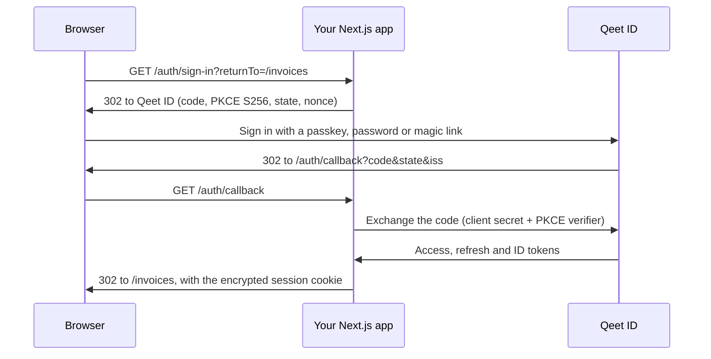

<div align="center">

# 🔐 Qeet ID for Next.js

**Sign-in, sessions and route protection for Next.js apps: people sign in on Qeet ID's hosted pages, and tokens stay on your server.**

[](#-you-need)
[](#-you-need)
[](#-typescript-and-modules)
[](#-how-sign-in-works)
[](#-sessions-and-cookies)
[](#-typescript-and-modules)
[](test)

[🌐 Qeet ID](https://id.qeet.in) · [📖 Docs](https://docs.qeet.in) · [🚀 Quick start](#-quick-start) · [⚛️ React SDK](https://github.com/qeetgroup/qeet-id-react) · [🟢 Node SDK](https://github.com/qeetgroup/qeet-id-node) · [📝 Changelog](CHANGELOG.md)

</div>

> [!IMPORTANT]
> The access, refresh and ID tokens never reach the browser. They live in an encrypted, HttpOnly cookie that
> only your server can read; the browser learns who is signed in, and nothing more.

## 🧭 What it's for

`@qeet-id/nextjs` adds **Sign in with Qeet ID** to a Next.js App Router app. Visitors sign in on Qeet ID's
hosted pages with a passkey, a password or a magic link (second factors included), and come back signed in.
Your Server Components, Server Actions and Route Handlers know who they are, your client components do too,
and your server can call your APIs as them.

## 📦 What's inside

| | |
|:--|:--|
| 🚪 **Session routes** | One Route Handler for sign-in, sign-up, the callback, the session, sign-out and switching organisation, as `@qeet-id/react` expects them |
| 🍪 **Sessions** | An AES-256-GCM encrypted, `__Host-Http-` prefixed, HttpOnly, `SameSite=Lax` cookie; secret rotation; chunked only when large |
| 🔁 **Renewal** | The access token is renewed with the refresh token a minute before it expires, once per refresh token, only where the new cookie can be stored |
| 🛡️ **Protection** | A proxy that sends signed-out visitors to sign in and back, and `requireSession()` for pages, Server Actions and Route Handlers |
| 👤 **Server helpers** | `getSession()`, `requireSession()` and `getAccessToken()` |
| ⚛️ **Client side** | Everything in `@qeet-id/react` (hooks, `SignInButton`, `UserButton`, `Protect`, …) and a provider that refreshes your Server Components when the session changes |
| 🔒 **Built in** | PKCE S256, `state`, `nonce`, the issuer check of RFC 9207, a CSRF header on every POST, same-origin return paths only, `no-store` everywhere |

## 🔗 How it fits

| Package | Runs in | Role |
|:--|:--|:--|
| [`@qeet-id/react`](https://github.com/qeetgroup/qeet-id-react) | Browser | The provider, hooks and components. Talks only to your app's `/auth/*` routes |
| **`@qeet-id/nextjs`** | Your Next.js server, and the browser | This package: the `/auth/*` routes, the session cookie, protection, server helpers |
| [`@qeet-id/node`](https://github.com/qeetgroup/qeet-id-node) | Server | The code exchange, token verification, renewal, revocation and the management API, used by this package |

### 🔑 How sign-in works



## 🧱 You need

| | |
|:--|:--|
| ⚙️ **Next.js** | 16, with the App Router, on the Node.js runtime (the default) |
| ⚛️ **React** | 19 |
| 🟢 **Node.js** | 22.12 or later, as `@qeet-id/node` needs |
| 🔐 **A Qeet ID application** | A confidential web application (the default type), allowed the `authorization_code` and `refresh_token` grants (the defaults) |

## 📥 Install

```sh
npm install @qeet-id/nextjs
# or: bun add @qeet-id/nextjs · pnpm add @qeet-id/nextjs · yarn add @qeet-id/nextjs
```

`@qeet-id/react` and `@qeet-id/node` come with it.

## ⚙️ Configure

In the Qeet ID console, open your application and register:

| Setting | Value |
|:--|:--|
| **Redirect URI** | `https://app.example.com/auth/callback` (and `http://localhost:3000/auth/callback` for development) |
| **Post-logout redirect URI** | `https://app.example.com/` |

Then set these in `.env.local` (and in your host's secrets):

```sh
QEET_ID_CLIENT_ID=app_…
QEET_ID_CLIENT_SECRET=…
QEET_ID_SECRET="$(openssl rand -base64 32)"   # encrypts the session cookie
QEET_ID_APP_URL=http://localhost:3000
```

| Variable | Required | Default | |
|:--|:--|:--|:--|
| `QEET_ID_CLIENT_ID` | ✅ | | The application's client id |
| `QEET_ID_CLIENT_SECRET` | ✅ | | The application's client secret |
| `QEET_ID_SECRET` | ✅ | | At least 32 random characters. A comma-separated list rotates: the first encrypts, every one decrypts |
| `QEET_ID_APP_URL` | ✅ | | Your app's origin, such as `https://app.example.com`. https, or http on `localhost` |
| `QEET_ID_BASE_URL` | | `https://api.id.qeet.in` | Qeet ID's API, where the OpenID Connect discovery document is |
| `QEET_ID_REDIRECT_URI` | | `{APP_URL}/auth/callback` | Only when the public callback address differs, such as behind a rewrite. Same origin as the app |
| `QEET_ID_POST_LOGOUT_REDIRECT_URI` | | `{APP_URL}/` | Where Qeet ID sends people after signing out |
| `QEET_ID_SCOPES` | | `openid profile email offline_access` | Space-separated; `openid` is required. `offline_access` asks for the refresh token |
| `QEET_ID_API_KEY` | | | A server-side API key with `tenant.read` and `role.read`, to add the organisation's name and the person's roles and permissions to the session |

Every variable is also an option of `createQeetID()`, which wins over the environment; `basePath` (default
`/auth`) and `sessionMaxAgeSeconds` (default 7 days) are options only. A missing or invalid setting throws a
`ConfigurationError` listing **every** problem at once, at the first request; during `next build` it waits, so
builds without secrets work.

## 🚀 Quick start

**1. Make one Qeet ID for the app**

```ts
// lib/qeet-id.ts
import { createQeetID } from "@qeet-id/nextjs";

export const qeetId = createQeetID();
```

**2. Add the session routes**

```ts
// app/auth/[...qeetid]/route.ts
import { qeetId } from "@/lib/qeet-id";

export const { GET, POST } = qeetId.handlers;
```

**3. Add the provider**, starting it with the server's session so the first render is already right:

```tsx
// app/layout.tsx
import { QeetIDProvider } from "@qeet-id/nextjs/client";
import { qeetId } from "@/lib/qeet-id";

export default async function RootLayout({ children }: { children: React.ReactNode }) {
  return (
    <html lang="en">
      <body>
        <QeetIDProvider initialSession={await qeetId.getSession()}>{children}</QeetIDProvider>
      </body>
    </html>
  );
}
```

**4. Add the proxy**, to renew sessions and protect paths:

```ts
// proxy.ts
import { qeetId } from "@/lib/qeet-id";

export default qeetId.proxy({ protect: ["/dashboard", "/invoices"] });

export const config = {
  matcher: ["/((?!_next/static|_next/image|favicon.ico|sitemap.xml|robots.txt).*)"],
};
```

**5. Sign in**

```tsx
"use client";
import { SignedIn, SignedOut, SignInButton, UserButton } from "@qeet-id/nextjs/client";

export function Header() {
  return (
    <header>
      <SignedOut><SignInButton returnTo="/dashboard" /></SignedOut>
      <SignedIn><UserButton showName /></SignedIn>
    </header>
  );
}
```

A plain link works too: `<a href="/auth/sign-in?returnTo=/dashboard">Sign in</a>`. A whole app is in
[examples/app-router](examples/app-router).

## 🛡️ Protecting pages

Protect in two places: the proxy for a fast redirect, and the page, Server Action or Route Handler for the
check that counts. Next.js's own advice is not to rely on the proxy alone: a matcher change can stop it
running, and Server Actions are POSTs to whatever page uses them.

| Where | How | Signed out |
|:--|:--|:--|
| `proxy.ts` | `qeetId.proxy({ protect: ["/dashboard"] })`, or `protect: (request) => boolean` | `GET`: 307 to `/auth/sign-in?returnTo=…`. Other methods: `401 not_signed_in` |
| A page or layout's Server Component | `const session = await qeetId.requireSession()` | Redirect to sign in, then back to this page |
| A Server Action | `await qeetId.requireSession({ returnTo: "/invoices" })` | Redirect to sign in |
| A Route Handler | `const session = await qeetId.getSession()`; answer `401` when `null` | Your answer |

A `protect` prefix covers the path and everything under it: `"/dashboard"` covers `/dashboard` and
`/dashboard/reports`, not `/dashboards`.

```tsx
// app/dashboard/page.tsx
import { qeetId } from "@/lib/qeet-id";

export default async function DashboardPage() {
  const session = await qeetId.requireSession();
  return <h1>Welcome, {session.user.name ?? session.user.email}</h1>;
}
```

`requireSession()` comes back to the page the proxy recorded (the `x-qeet-id-return-to` request header it
sets), or to `returnTo`, or to `/`. Layouts don't re-render when you navigate between their pages, so check in
the page, not only in a layout.

## 👤 The session on the server

```ts
const session = await qeetId.getSession(); // Session | null
```

| Field | | From |
|:--|:--|:--|
| `user.id` | string | the ID token's `sub` |
| `user.email` · `user.emailVerified` | string \| null · boolean | `email`, `email_verified` (the `email` scope) |
| `user.name` · `user.picture` | string \| null | `name`, `picture` (the `profile` scope), when the person has them |
| `organization` | `{ id, name }` \| null | `tenant_id`; `name` with `QEET_ID_API_KEY` |
| `roles` · `permissions` | string[] | role names and permission keys, with `QEET_ID_API_KEY`; otherwise `[]` |
| `expiresAt` | ISO 8601 string | when the session ends unless renewed |

It works in Server Components, Server Actions and Route Handlers, reads the cookie once per render, and never
calls Qeet ID. Reading it makes the route dynamic; with [Cache Components](https://nextjs.org/docs/app/guides/authentication-with-cache-components),
read it inside a `<Suspense>` boundary (or a `"use cache: private"` function), never in a plain `"use cache"` one.

> [!NOTE]
> `roles` and `permissions` are for showing and hiding things. Decide what a person may do on the server, with
> Qeet ID's permission check (`qeetId.permissions.check` in `@qeet-id/node`) or your own rules.

## 🔑 Calling your APIs

```ts
// app/invoices/actions.ts
"use server";
import { qeetId } from "@/lib/qeet-id";

export async function approveInvoice(invoiceId: string) {
  await qeetId.requireSession();
  const accessToken = await qeetId.getAccessToken();
  await fetch(`https://api.example.com/invoices/${invoiceId}/approve`, {
    method: "POST",
    headers: { authorization: `Bearer ${accessToken}` },
  });
}
```

`getAccessToken()` renews the token when it has less than a minute left. It throws an `AccessTokenError`:

| `code` | When | |
|:--|:--|:--|
| `not_signed_in` | nobody is signed in | sign in |
| `session_ended` | Qeet ID refused the renewal: signed out elsewhere, revoked, or suspended | sign in again |
| `cookies_read_only` | the token expired in a Server Component, where Next.js can't store a renewed one | let the proxy renew, or call it from a Server Action or Route Handler |
| `session_unavailable` | the token expired and Qeet ID couldn't be reached | try again shortly |

Never send the access token to the browser.

## 🏢 Organisations

Qeet ID signs people in to **the application's own organisation**: an application's tokens always carry its
organisation's `tenant_id`, and a person who isn't a member is refused. So `session.organization` is that
organisation, and `POST /auth/switch-organization` answers `501 organization_switch_unavailable` for any other.
With `QEET_ID_API_KEY` the session also carries the organisation's name and the person's role names and
permission keys there, looked up at sign-in and at each renewal.

## 🚪 Signing out

`<SignOutButton>` and `<UserButton>`'s menu (or `useQeetID().signOut()`) call `POST /auth/sign-out`, which:

1. revokes the refresh token at Qeet ID, and clears the session cookie;
2. answers `{ "redirectTo": … }`: Qeet ID's sign-out address with `id_token_hint`, so Qeet ID ends its own
   session without asking;
3. Qeet ID then sends the browser to `QEET_ID_POST_LOGOUT_REDIRECT_URI`.

A `returnTo` given to sign-out travels in the `state` query parameter of that last redirect. To honour it,
read `state` on the post-logout page and pass it through `safeReturnTo(state, origin)` (exported by this
package) before redirecting. Signing out without a session answers `200` too.

## 🍪 Sessions and cookies

| | |
|:--|:--|
| 🍪 **Session cookie** | `__Host-Http-qeet-id-session` (`qeet-id-session` on plain-http localhost): `Secure`, `HttpOnly`, `SameSite=Lax`, `Path=/`, no `Domain`. About 2.5 KB; split into `.0`, `.1`, … only past 3800 characters |
| 🔐 **Encryption** | AES-256-GCM with a key derived from `QEET_ID_SECRET` (HKDF-SHA-256); tampered or foreign cookies are cleared |
| 🔄 **Rotating the secret** | Set `QEET_ID_SECRET=new,old`. Sessions sealed with `old` keep working and move to `new` at their next renewal; drop `old` after `sessionMaxAgeSeconds` |
| ⏳ **Lifetime** | Renewed sessions roll on for `sessionMaxAgeSeconds` (7 days) from each renewal. Without a refresh token, the session ends with the access token |
| 🔁 **Renewal** | A minute before the access token expires, in the proxy, `GET /auth/session` or `getAccessToken()`. Never in a Server Component render, where the rotated refresh token couldn't be stored |
| ⚡ **Parallel requests** | Requests carrying the same refresh token share one renewal in a process, and its answer for 30 seconds. Qeet ID ends the session if a refresh token is used twice |
| 🚪 **Signed out elsewhere** | Takes effect at the next renewal, within the access token's lifetime (10 minutes by default) |
| ✍️ **Sign-in cookie** | `__Secure-qeet-id-sign-in.<state>`: the `state`, `nonce` and PKCE verifier, sent only to the callback, for 10 minutes |

## 🧱 The routes

Under `basePath` (default `/auth`). Pass a different one to both `createQeetID({ basePath })` and
`<QeetIDProvider basePath={qeetId.basePath}>`, and put the route file under it.

| Route | | Answers |
|:--|:--|:--|
| `GET /auth/sign-in?returnTo=` | a page navigation | `302` to Qeet ID's authorization endpoint |
| `GET /auth/sign-up?returnTo=` | the same; Qeet ID's hosted page offers sign-up | `302` |
| `GET /auth/callback` | Qeet ID's redirect | `302` to the saved path, or to it with `?authError=<code>` |
| `GET /auth/session` | `fetch` | `200 { "session": Session \| null }`; `503 session_unavailable` |
| `POST /auth/sign-out` | `fetch`, header `X-Qeet-ID-Request: 1`, optional `{ "returnTo" }` | `200 { "redirectTo" }` |
| `POST /auth/switch-organization` | `fetch`, the same header, `{ "organizationId" }` | `200 { "session" }`, or `501` |

Errors are `{ "error": { "code", "message" } }` with `Cache-Control: no-store`: `invalid_request` 400,
`not_signed_in` 401, `csrf_rejected` 403, `not_found` 404, `method_not_allowed` 405, `internal_error` 500,
`organization_switch_unavailable` 501, `session_unavailable` 503. A failed sign-in comes back as `authError`:
Qeet ID's own OAuth code (`access_denied`, `invalid_scope`, …), `invalid_state` or `session_unavailable`;
`@qeet-id/react` reports it through `onError`. The contract in full is `@qeet-id/react`'s
[session contract](https://github.com/qeetgroup/qeet-id-react/blob/main/docs/session-contract.md).

## 🔒 Security

| | |
|:--|:--|
| 🕵️ **Tokens** | Server-only; never in the session JSON, logs or errors |
| 🧾 **Sign-in** | PKCE S256, `state` and `nonce` per sign-in; the callback's issuer (RFC 9207), the ID token's signature, issuer, audience, expiry and nonce |
| 🛑 **CSRF** | Every POST needs `X-Qeet-ID-Request: 1`, which no other site can send without a CORS preflight these routes never answer; `Sec-Fetch-Site: cross-site` is refused; no state changes on GET |
| ↪️ **Redirects** | Same-origin paths only, through `safeReturnTo`; built on `QEET_ID_APP_URL`, never the request's `Host` |
| 🗄️ **Caching** | `Cache-Control: no-store` on every session route; `private, no-store` when the proxy sets a cookie |

## 🚨 Errors

| Class | `code` | When |
|:--|:--|:--|
| `ConfigurationError` | `invalid_configuration` | a setting is missing or invalid; `problems` lists them all |
| `AccessTokenError` | see [Calling your APIs](#-calling-your-apis) | `getAccessToken()` has no token to give |

Both extend `QeetIDError` from `@qeet-id/node`, exported here too. In the browser, `@qeet-id/react` reports
failures as its own `QeetIDError`, exported by `@qeet-id/nextjs/client`.

## 🧩 TypeScript and modules

An ES module package with declarations. `@qeet-id/nextjs` is server-only (it imports `server-only`);
`@qeet-id/nextjs/client` re-exports `@qeet-id/react`, whose components and hooks carry their own
`"use client"`, so its types, `QeetIDError` and `VERSION` import into Server Components too. Route Handlers
and the proxy must run on the Node.js runtime, Next.js's default.

```ts
import type { Session, QeetIDNextOptions, ProxyOptions } from "@qeet-id/nextjs";
```

## 🔨 Building

```sh
bun install
bun run verify   # typecheck (the example too), Biome, tests, build, publint and Are the Types Wrong
```

## 📚 Learn more

| | |
|:--|:--|
| 🧪 [Example](examples/app-router) | An App Router app: routes, proxy, provider, a protected page, a Server Action, a Route Handler |
| 📐 [Engineering practices](docs/engineering-practices.md) | What this package follows, with sources |
| 🧠 [Design decisions](docs/design-decisions) | The Route Handler, the cookie session, renewal, ES modules |
| 📝 [Changelog](CHANGELOG.md) | What's in each version |
| 🔒 [Security](SECURITY.md) | Reporting a vulnerability to security@qeet.in |

---

<div align="center">

Made with 🧡 by Qeet Group · [⬆️ Back to top](#-qeet-id-for-nextjs)

</div>
