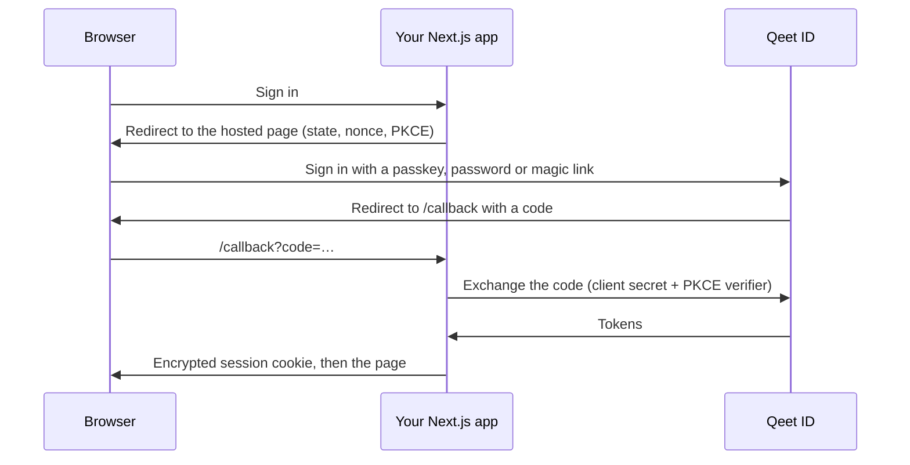

# 🔐 Qeet ID for Next.js

**Sign-in, sessions and route protection for Next.js apps: people sign in on Qeet ID's hosted pages, and tokens stay on your server.**

[🌐 Qeet ID](https://id.qeet.in) · [📖 Docs](https://docs.qeet.in) · [⚛️ React SDK](https://github.com/qeetgroup/qeet-id-react) · [🟢 Node SDK](https://github.com/qeetgroup/qeet-id-node)

## 🧭 What it's for

`@qeet-id/nextjs` adds **Sign in with Qeet ID** to a Next.js app. Visitors sign in on Qeet ID's hosted pages with a passkey, a password or a magic link, and come back signed in. Your Server Components, Route Handlers and Server Actions know who they are, and so do your client components. The access and refresh tokens live in an encrypted, http-only cookie session on your server; the browser never holds them.

## 📦 What's inside

| | |
|:--|:--|
| 🚪 **Route handlers** | Sign-in, callback and sign-out for the App Router, with state, nonce and PKCE checked on the way back |
| 🍪 **Sessions** | An encrypted, http-only, `SameSite` cookie session, renewed before the access token expires |
| 🛡️ **Protection** | Middleware and a server helper that send signed-out visitors to sign in, and back where they were |
| 👤 **Server helpers** | The signed-in person and their organisation in Server Components, Route Handlers and Server Actions |
| 🏢 **Organisations** | Switching organisation re-issues the session for the one chosen |
| ⚛️ **Client side** | `@qeet-id/react`'s hooks and buttons, wired to these routes |

## 🔗 How it fits

| Package | Runs in | Role |
|:--|:--|:--|
| [`@qeet-id/react`](https://github.com/qeetgroup/qeet-id-react) | Browser | `useUser`, `useSession`, sign-in and sign-out buttons, `SignedIn` / `SignedOut` |
| **`@qeet-id/nextjs`** | Next.js server and browser | This package: routes, session, protection |
| [`@qeet-id/node`](https://github.com/qeetgroup/qeet-id-node) | Server | Code exchange, token verification, the management API |

## 🔑 How sign-in works

## 🧱 You need

| | |
|:--|:--|
| ⚙️ **Next.js** | The App Router, with React 19 |
| 🟢 **Node.js** | 22.12 or later, as `@qeet-id/node` needs |
| 🔐 **A Qeet ID application** | A confidential web application in your organisation, with your callback URL as a redirect URI |

## 🛠️ Working on it

| | |
|:--|:--|
| 🌿 **Branches** | Work lands on `develop`; `main` changes only by a pull request from `develop` |
| 🏷️ **Versions** | `vX.Y.Z` tags, made when the release workflow is run on `main` |
| 📦 **Package manager** | bun |

Made with 🧡 by Qeet Group · [⬆️ Back to top](#-qeet-id-for-nextjs)

